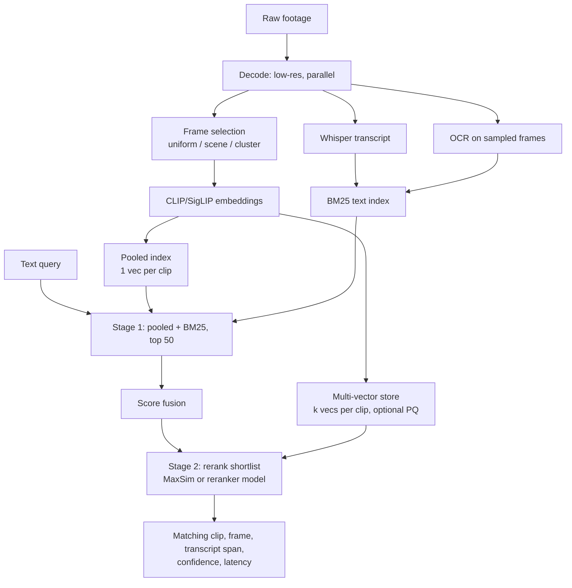

# VideoGrep: Design Document

A measured search stack for raw footage, built against Cardboard's "Multimodal Understanding" problem (#03).

## Start here: the approach in plain English

**The problem.** You have hours of raw video and you remember roughly what you want ("the part where he explains the diagram"). Text search can't help because video has no words in it to match.

**The core trick.** An AI model turns each frame or clip into a list of numbers (an *embedding*). Clips that look or mean similar get similar numbers. Your text query is turned into numbers the same way, and the system returns the clips whose numbers are closest. That is "grep for video."

**Why it struggles.** Doing this over lots of footage is slow (every frame has to be processed) and sometimes wrong (one list of numbers can't capture everything in a clip, and embeddings miss exact words and on-screen text).

**What this project does.** It asks three questions and measures the answer to each:

1. **What do we store?** Which frames to keep, whether to describe a clip with one list of numbers or several, and how much to shrink them (frame selection, pooled vs. multi-vector, compression).
2. **What else do we search?** Spoken words (transcripts) and on-screen text (OCR), which are exact and cheap, alongside the embeddings.
3. **In what order do we check?** A fast, rough pass over everything first, then a slow, careful pass over only the best 50 candidates (staged search).

**Example.** Query: *"where he says deploy"*. The transcript index finds the exact moment instantly; embeddings would struggle. Query: *"whiteboard with a diagram"*. Embeddings find it; the transcript can't. The combined system should handle both, and the experiment measures how much each part contributes.

**Size sense-check.** One frame every 2 seconds is 1,800 frames per hour. At 2 KB per frame vector that is about 3.7 MB per hour. Storage is small at this level; it only grows when you keep many frames or many vectors per clip. That's why the grid tests those choices.

Terms are explained in the glossary at the end (Section 11).

## 1. Problem statement

> There is no grep equivalent for video. Text is searchable by default. Video is not. Finding the right clip from a large media library today relies on multimodal embeddings that are either too slow or too inaccurate for real-time use in an editing workflow. The same applies to images, audio, and graphics. This requires innovation across model quality, embedding infrastructure, indexing architecture, and UX that makes search feel instant and precise even over 100s of gigs of multimodal input.

## 2. Goal and claim

Not "a better search engine than Cardboard's." The goal is a **measured answer** to one question:

> At a fixed index budget per hour of footage, which design choices (frame selection, scoring, compression, extra signals, staging) give the best recall and latency, and how much does each one contribute?

Constraints: CPU laptop, free Colab GPU for batch embedding, $0 spend, off-the-shelf models only (no training).

## 3. Where each part of the problem statement is addressed

| Problem statement phrase | What this project does | Where (section) | Evidence produced | Honest limit |
| --- | --- | --- | --- | --- |
| "No grep for video" | Text query returns timestamped moments, mixing keyword and semantic search | 5.6, 5.7 | Working demo, recall@k | Demo, not an editor plugin |
| "Embeddings too slow" | Profile the pipeline, then cut cost: low-res decoding, batching, frame selection, quantization, two-stage search | 5.1, 5.2, 5.4, 5.7 | Latency breakdown, indexing speed (x real-time) | CPU numbers; production GPUs differ |
| "Embeddings too inaccurate" | Multi-vector scoring, reranking, and cheap exact signals (transcripts, OCR) fused with embeddings | 5.3, 5.5, 5.6, 5.7 | Recall by query type, ablations | Still limited by off-the-shelf embedding quality |
| "Model quality" | Compare a cheap model (CLIP) with a strong 2B embedding model (Qwen3-VL-Embedding-2B or WeMM-Embedding-2B, run on Colab); show where each fails | 6 | Per-model recall table | Not training or fine-tuning models |
| "Embedding infrastructure" | Decode and embed pipeline: low-res decoding, parallel decode, batched embedding, caching | 5.1 | Throughput numbers | Single machine |
| "Indexing architecture" | Index-time grid (selection x representation x compression) plus hybrid index and staged retrieval | 5.2 to 5.7 | Recall vs. index size vs. latency curves | Small corpus; extrapolated |
| "UX: instant and precise" | Live latency readout, progressive results (coarse first, refined after), incremental indexing, preview on hover | 5.8 | Demo video, p50/p95 latency | Standalone UI, not integrated in a timeline |
| "100s of gigs" | Index-size-per-hour math plus synthetic scale-up of the index | 5.9 | Scaling curves | Extrapolation. Not a real test at that size |
| "Images, audio, graphics" | Images as single frames; audio via transcripts; graphics via OCR | 5.5 | Per-modality recall | Stretch goal; no audio-event or graphic-specific models |

## 4. Architecture

## 5. Components

### 5.1 Ingestion and decoding (infrastructure)

- ffmpeg decodes at low resolution (e.g. 224 px short side) since embedding models downsize anyway. Parallelize across files.
- Store frame timestamps with every vector so results map back to a position in the source.
- **Measure:** indexing time per hour of footage, split into decode, embed, and index-write.

**Hypothesis to test:** at this scale, decoding and embedding time dominates, not search time. MetaEmbed's paper reports the same pattern for its setup (query encoding costs far more than scoring), so measure before optimizing anything else.

### 5.2 Frame selection (what we keep)

Three strategies at equal vector budgets:

- **Uniform:** one frame every N seconds (baseline; VLM2Vec-V2 uses 8 uniform frames per video).
- **Scene-change:** keep a frame at each detected cut (e.g. PySceneDetect).
- **Cluster-representative:** cluster a video's frame embeddings and keep the frame nearest each centroid. This is inspired by VideoRAG, which clusters frames to reduce the frame-selection space and argues uniform sampling can drop key frames while keeping redundant ones.
- **Shot level:** also store one entry per detected shot (a continuous camera take) with its start and end time. Search shots first, then drill into frames inside the best shots. This gives three granularities: clip, shot, frame.

### 5.3 Representation and scoring (how we match)

- **Pooled:** mean of a clip's frame vectors, one vector per clip. Fast and compact; may blur details.
- **Multi-vector:** keep k frame vectors per clip, score a query with MaxSim (best-matching frame). Preserves detail; costs memory.
- This is a no-training analogue of MetaEmbed's idea of trading vectors per item for quality, vs. index size and latency. MetaEmbed learns the vectors; here we just keep real frame vectors.

### 5.4 Compression (how we store)

- Raw float32 vs. FAISS product quantization (PQ) at a few code sizes.
- **Matryoshka truncation:** some models (WeMM-Embedding, for example) are trained so the first N numbers of each vector still work on their own. You can cut a 2048-number vector to 512 or 256 and re-normalize, with no extra training. Test recall at each size.
- Reference arithmetic: a 512-d float32 vector is 2 KB. One frame every 2 s gives 1,800 vectors per hour, about 3.7 MB. So single-vector-per-frame indexes are small. Memory only becomes a problem with dense sampling or many vectors per clip, which is exactly what this grid tests.

### 5.5 Cheap exact signals (what else we search on)

- **Speech:** faster-whisper transcripts, segmented with timestamps, indexed with BM25.
- **On-screen text and graphics:** OCR on sampled frames, indexed the same way.
- **Why:** names, spoken phrases, and slide or UI text are things embeddings handle poorly and keyword search handles exactly. I expect this to win on those query types; the experiment will confirm or refute it.

### 5.6 Fusion

- Normalize scores from the pooled index and BM25, combine with a weight tuned on a held-out slice of queries (reciprocal rank fusion as a simple alternative).
- **Measure:** recall per query type with and without each signal.

### 5.7 Staged retrieval (how we spend compute)

- **Stage 1 (cheap):** pooled vector search plus BM25 over the whole library, return the top 50 candidates.
- **Stage 2 (expensive):** rerank the shortlist with either MaxSim over each candidate's k vectors, or a ready-made reranker model (Qwen publishes Qwen3-VL-Reranker in 2B and 8B sizes; the 2B is the practical one for you). Compare the two.
- The same recall-then-rerank shape appears in R^3 (composed video retrieval), applied here to text-to-moment search in a clip library.
- **Measure:** recall and latency of stage 1 alone, stage 2 alone (on all clips), and staged.

### 5.8 UX layer (feels instant)

- Streamlit (or React) page: query box, ranked clips with timestamps and short previews, live latency readout split into query encoding, retrieval, rerank.
- **Evidence per result:** show the matching frame, the transcript span, and a confidence score, so an editor can see why a clip matched.
- **Progressive results:** show stage-1 results immediately, replace with reranked results when stage 2 finishes.
- **Incremental indexing:** new clips become searchable as they finish processing, with no full rebuild.
- **Measure:** time to first result, time to final result, p50 and p95.

### 5.9 Scale test (100s of gigs, honestly)

- Replicate real vectors with noise to 10x, 50x, 100x the corpus and measure memory, index build time, and query latency.
- Extrapolate with explicit formulas (vectors per hour x hours x bytes per vector) and state them as estimates.

## 6. Evaluation

**Data:** 60-80 clips (3-5 hours): your own messy phone, screen and event recordings plus license-checked open footage. Messy footage matters because clean stock clips flatter every method.

**Queries:** 60-100, each labeled with the correct clip and time interval, tagged by type:

1. Visual ("whiteboard with a diagram")
2. Spoken ("where he says 'deploy'")
3. On-screen text ("slide titled Results")
4. Audio event ("laughter", "door slam")
5. Abstract ("energetic moment")

**Metrics:** recall@1/5/10 (hit if the returned moment overlaps the labeled interval within a stated tolerance), temporal IoU (how much the returned time range overlaps the true one), nDCG (whether the right clip is ranked near the top), p50/p95 latency split by stage, index size in MB per hour of footage, indexing speed (x real-time).

**Baselines:**

- B0 (cheap): uniform frames, pooled CLIP vector, flat FAISS, runs on CPU.
- B1 (strong, Colab): Qwen3-VL-Embedding-2B or WeMM-Embedding-2B on the same clips. A 2B model should fit a free T4 GPU; 9B models probably will not. VLM2Vec-V2 is dropped as a baseline because newer models score far higher on MMEB-v2 (59.3 vs. 77.9 for WeMM-2B, as reported).

**Ablation grid:** frame selection (3) x scoring (2) x compression (raw, PQ, Matryoshka truncation) at a fixed vector budget; then add BM25 fusion; then add staging. Change one factor at a time.

**Reporting:** tradeoff curves (recall vs. index size, recall vs. latency), a per-query-type table, and a failure gallery of misses with the reason.

## 7. What this does not address

- **Model quality:** no training or fine-tuning. Quality gains come from compensating around the embedding, not improving it.
- **Real 100s-of-GB scale:** extrapolated only.
- **Audio events and graphics:** limited to transcripts and OCR. No dedicated audio embedding or graphics model.
- **Editor integration:** standalone demo, no timeline or real-time editing loop.
- **Large models:** 7-9B embedding models and rerankers are out of reach on your hardware; the study uses 2B models at most.
- **Novelty:** the components are known ideas (multi-vector retrieval, frame selection, hybrid search, reranking). The contribution is the combined, measured comparison on messy footage, not a new algorithm.

## 8. Risks and mitigations

| Risk | Mitigation |
| --- | --- |
| Small test set, weak conclusions | State sizes and confidence plainly; label carefully; fewer, better queries |
| Embeddings too slow on CPU | Use Colab GPU for batch indexing; keep query-time on CPU to measure realistic latency |
| Dataset license issues | Use own footage and verify each open dataset's license before releasing anything |
| Cardboard already does this | Present as "tradeoff numbers I measured," not "what you're missing" |
| Scope creep | Build in the order of section 5; stop after 5.7 if time runs short |

## 9. Timeline (about 2 weeks)

| Days | Work |
| --- | --- |
| 1-2 | Collect footage, write and label queries |
| 3-4 | Baseline B0, profile where time goes |
| 5-7 | Index-time grid (5.2 to 5.4) |
| 8-9 | Transcripts, OCR, fusion, staged retrieval (5.5 to 5.7) |
| 10-11 | UI, incremental and progressive behavior, scale test |
| 12-14 | Write-up, demo video, outreach |

## 10. Source notes

- **MetaEmbed (ICLR 2026):** motivates the quality / index size / latency tradeoff and the observation that encoding cost outweighs scoring cost. Its numbers are for image-text retrieval on an A100, not video.
- **VideoRAG (ACL Findings 2025):** motivates cluster-based frame selection over uniform sampling.
- **VLM2Vec-V2 (2025):** introduced the MMEB-V2 video and moment-retrieval benchmark framing and uses 8 uniform frames per video; now a weak baseline.
- **WeMM-Embedding, Qwen3-VL-Embedding/Reranker, Ovis-Embedding (2026):** stronger embedding models plus a ready-made reranker. Their scores are self-reported aggregates over image, video and document tasks, not tests on long raw footage.
- **R^3 and related reranking work:** motivate the staged recall-then-rerank design.

Verify each paper's details yourself before citing them in outreach.

## 11. Glossary

| Term | Plain meaning |
| --- | --- |
| **Embedding / vector** | A list of numbers (e.g. 512) that a model produces for a frame, clip or sentence. Similar content gets similar numbers. |
| **Embedding model (CLIP, SigLIP, Qwen3-VL-Embedding, WeMM)** | The AI that produces those lists. Bigger models are usually more accurate and slower. "2B" means 2 billion parameters. |
| **Pooled vector** | One vector for a whole clip, made by averaging its frame vectors. Compact, loses detail. |
| **Multi-vector** | Keeping several vectors per clip (one per kept frame) instead of one. More detail, more memory. |
| **MaxSim / late interaction** | Compare the query to each of a clip's vectors and take the best match as the clip's score. A single great frame can win the clip. |
| **Index** | The stored, searchable structure built from all the vectors (or words). Built once, searched many times. |
| **FAISS** | A free library for fast vector search. "Flat" means compare against everything (exact, slower at scale). |
| **ANN (approximate nearest neighbor)** | Search methods that find *nearly* the closest vectors much faster than checking all of them. |
| **BM25** | Classic keyword search scoring (like a search engine). Great for exact words and names. |
| **Hybrid retrieval / fusion** | Run keyword and vector search together and merge their scores into one ranking. |
| **ASR / Whisper** | Speech-to-text. Whisper is a free model that produces a transcript with timestamps. |
| **OCR** | Reading text that appears in frames (slides, UI, signs). |
| **Scene / shot detection** | Finding where the camera cuts, so you keep one representative frame per shot instead of many near-duplicates. |
| **Frame selection** | Deciding which frames to embed at all (uniform spacing, one per shot, or one per cluster of similar frames). |
| **Product quantization (PQ)** | Compressing vectors by splitting them into pieces and storing short codes. Smaller index, small accuracy loss. |
| **Matryoshka embeddings** | Vectors built so you can keep just the first N numbers and still get usable search. Like nesting dolls. |
| **Staged retrieval** | Cheap rough search over everything, then expensive careful scoring on the top candidates only. |
| **Reranker** | A model that reads the query and one candidate together and scores how well they match. More accurate than comparing vectors, too slow for everything. |
| **recall@k** | Out of all queries, how often the correct moment is in the top k results. |
| **Temporal IoU** | How much the returned time range overlaps the true one (0 = none, 1 = exact). |
| **nDCG** | A ranking-quality score that rewards putting the correct result near the top. |
| **p50 / p95 latency** | Typical response time (p50) and the slow-case time (p95: 95% of queries are faster than this). |
| **MMEB-v2** | A public benchmark that scores embedding models across image, video and document tasks. Scores are averages and don't guarantee performance on your footage. |